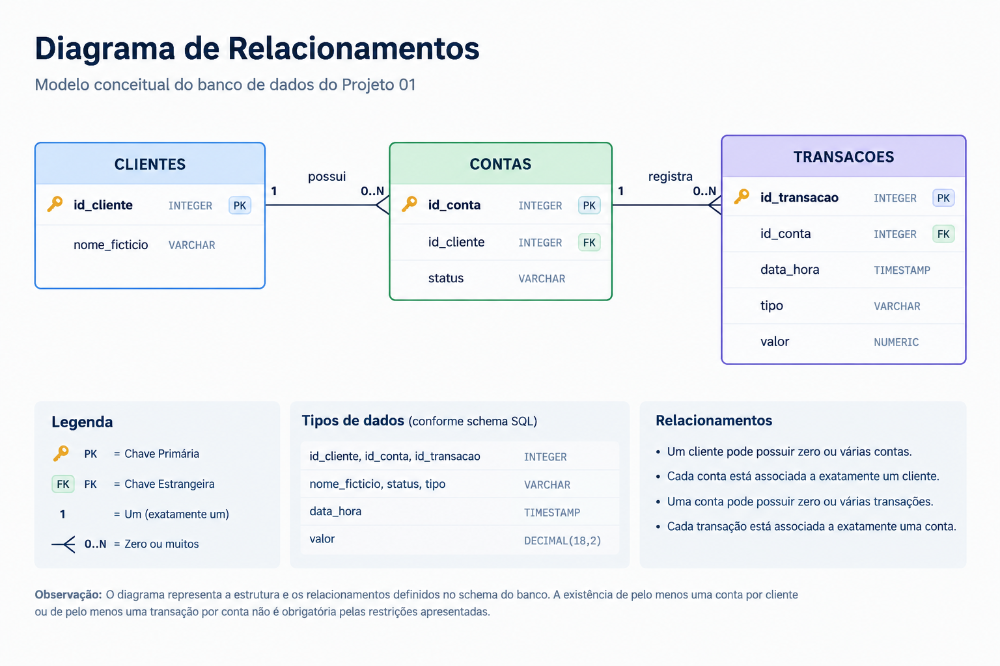

# Projeto 01 — Banco de Dados Transacional

## 1. Objetivo

Construir um banco de dados relacional para representar clientes, contas bancárias e transações financeiras fictícias.

O projeto tem como objetivo praticar conceitos fundamentais de Engenharia de Dados, incluindo modelagem relacional, definição de chaves primárias e estrangeiras, integridade referencial, consultas SQL e validação de resultados.

## 2. Tecnologias utilizadas

- **DuckDB:** banco de dados relacional utilizado para armazenar e consultar os dados.
- **SQL:** linguagem utilizada para criação das tabelas, inserção de dados e consultas.
- **Python:** utilizado para conectar ao DuckDB e executar comandos SQL.
- **VS Code:** ambiente de desenvolvimento.

## 3. Modelo de dados

O banco de dados possui três tabelas principais:

- `clientes`: armazena os dados cadastrais dos clientes.
- `contas`: armazena as contas bancárias associadas aos clientes.
- `transacoes`: armazena as movimentações financeiras realizadas nas contas.


### 3.1. Diagrama de relacionamentos


**Legenda:**

- **PK (Primary Key):** chave primária que identifica unicamente cada registro.
- **FK (Foreign Key):** chave estrangeira que referencia um registro de outra tabela.
- **Relacionamento 1:N:** um registro da tabela de origem pode estar relacionado a vários registros da tabela de destino.

### 3.2. Relacionamentos

- Um cliente pode possuir várias contas.
- Cada conta pertence a um cliente.
- Uma conta pode possuir várias transações ou nenhuma.
- Cada transação pertence a uma conta.

As chaves estrangeiras representam os relacionamentos entre as tabelas e ajudam a preservar a integridade referencial dos dados.

## 4. Granularidade das tabelas

A granularidade define o que uma única linha representa em uma tabela. Essa definição é importante para evitar duplicidades e interpretar corretamente os resultados das consultas.

### 4.1. Tabela `clientes`

**Granularidade:** uma linha por cliente cadastrado.

Cada registro representa um cliente único, identificado por `id_cliente`.

- **Chave primária:** `id_cliente`.
- **Relacionamento:** um cliente pode possuir várias contas.

Exemplo: um cliente que possui duas contas aparece uma única vez na tabela `clientes`.

### 4.2. Tabela `contas`

**Granularidade:** uma linha por conta bancária.

Cada registro representa uma conta específica, identificada por `id_conta` e associada a um cliente por meio de `id_cliente`.

- **Chave primária:** `id_conta`.
- **Chave estrangeira:** `id_cliente`.
- **Relacionamento:** cada conta pertence a um cliente e pode possuir várias transações.

Exemplo: um cliente com as contas 101 e 102 possui dois registros na tabela `contas`.

### 4.3. Tabela `transacoes`

**Granularidade:** uma linha por transação financeira registrada.

Cada registro representa uma movimentação individual, identificada por `id_transacao` e associada a uma conta por meio de `id_conta`.

- **Chave primária:** `id_transacao`.
- **Chave estrangeira:** `id_conta`.
- **Relacionamento:** uma conta pode possuir várias transações.

Exemplo: se uma conta realizar cinco transações, haverá cinco registros correspondentes na tabela `transacoes`.

## 5. Decisões técnicas

### Modelagem relacional

As informações foram separadas em três tabelas para representar entidades distintas e seus relacionamentos.

Essa separação facilita a organização dos dados e permite consultar informações de clientes, contas e transações de forma relacionada.

### Chaves primárias e estrangeiras

As chaves primárias identificam unicamente cada registro. As chaves estrangeiras estabelecem os relacionamentos entre as tabelas.

### Tipo de dado para valores financeiros

O tipo `DECIMAL` é adequado para valores monetários porque permite representar valores com precisão decimal, evitando os problemas de aproximação comuns em tipos de ponto flutuante.

### Dados sintéticos

O projeto utiliza dados fictícios para demonstrar o funcionamento do modelo e validar os cenários das consultas sem depender de informações bancárias reais.

### DuckDB

O DuckDB foi escolhido para armazenar os dados e executar as consultas SQL em um ambiente local, facilitando o desenvolvimento e a reprodução do projeto.

## 6. Estrutura do projeto

```text
projeto01/
├── README.md
├── schema.sql
├── queries.sql
└── data/
    └── banco.duckdb
```

A estrutura acima é ilustrativa. Os nomes e caminhos devem corresponder aos arquivos existentes no ambiente de desenvolvimento.

## 7. Consultas SQL e resultados

As consultas abaixo foram executadas no DuckDB utilizando os dados sintéticos do projeto.

### 7.1. Valor total por conta e dia

**Objetivo:** calcular o valor total das transações por conta e por dia.

**Granularidade do resultado:** uma linha por conta e dia com transações registradas.

```sql
SELECT
    id_conta AS conta,
    CAST(data_hora AS DATE) AS dia,
    SUM(valor) AS valor_total
FROM transacoes
GROUP BY 1, 2
ORDER BY 1, 2;
```

**Resultado:**

| Conta | Dia | Valor total |
|---:|---|---:|
| 101 | 2026-10-01 | 1700.00 |
| 101 | 2026-10-02 | 350.00 |
| 101 | 2026-10-05 | 800.00 |
| 102 | 2026-10-02 | 2000.00 |
| 102 | 2026-10-03 | 600.00 |
| 102 | 2026-10-05 | 250.00 |
| 201 | 2026-10-01 | 3000.00 |
| 201 | 2026-10-02 | 750.00 |
| 201 | 2026-10-04 | 400.00 |
| 201 | 2026-10-06 | 1200.00 |

**Interpretação:**

A consulta retorna 10 combinações de conta e dia com movimentações registradas.

- `CAST(data_hora AS DATE)` extrai a data, desconsiderando o horário.
- `SUM(valor)` soma os valores das transações.
- `GROUP BY 1, 2` agrupa os registros por conta e dia.
- `ORDER BY 1, 2` ordena o resultado por conta e data.

A consulta soma os valores sem distinguir créditos de débitos.

### 7.2. Quantidade total de transações

**Objetivo:** identificar a quantidade de transações registradas no banco.

```sql
SELECT
    COUNT(id_transacao) AS quantidade_transacoes
FROM transacoes;
```

**Resultado:**

| Quantidade de transações |
|---:|
| 12 |

**Interpretação:**

A tabela `transacoes` contém 12 registros com `id_transacao` preenchido.

Como essa coluna é a chave primária, cada registro representa uma transação identificada de forma única.

A consulta retorna um único valor, correspondente à quantidade total de transações.

### 7.3. Contas sem movimentação

**Objetivo:** identificar contas que não possuem transações registradas.

```sql
SELECT
    c.id_conta
FROM contas c
LEFT JOIN transacoes t
    ON c.id_conta = t.id_conta
WHERE t.id_conta IS NULL;
```

**Resultado:**

| id_conta |
|---:|
| 301 |

**Interpretação:**

A conta 301 está cadastrada na tabela `contas`, mas não possui registros correspondentes na tabela `transacoes`.

- `LEFT JOIN` mantém todas as contas da tabela de origem.
- `IS NULL` identifica as contas sem correspondência na tabela de transações.

Essa consulta demonstra como identificar registros sem relacionamento correspondente em outra tabela.

### 7.4. Saldo líquido por conta

**Objetivo:** calcular a diferença entre os valores de créditos e débitos de cada conta.

```sql
SELECT
    id_conta,
    COALESCE(
        SUM(valor) FILTER (WHERE tipo = 'credito'),
        0
    )
    -
    COALESCE(
        SUM(valor) FILTER (WHERE tipo = 'debito'),
        0
    ) AS saldo_liquido
FROM transacoes
GROUP BY 1
ORDER BY 1;
```

**Resultado:**

| Conta | Saldo líquido |
|---:|---:|
| 101 | 2450.00 |
| 102 | 1150.00 |
| 201 | 3850.00 |

**Interpretação:**

O saldo líquido é calculado pela diferença entre o total de créditos e o total de débitos de cada conta que possui transações.

- `FILTER` permite somar separadamente os valores de cada tipo de transação.
- `COALESCE` substitui um resultado nulo por zero.
- `GROUP BY 1` agrupa as transações por conta.

O resultado representa o saldo líquido das movimentações registradas no conjunto de dados, e não necessariamente o saldo bancário real, pois não considera eventuais saldos iniciais.

A conta 301 não aparece porque a consulta parte da tabela `transacoes`. Para incluir contas sem movimentação, seria necessário utilizar `contas` como tabela de origem e realizar um `LEFT JOIN`.

## 8. Resumo dos resultados

| Indicador | Resultado |
|---|---:|
| Quantidade total de transações | 12 |
| Combinações de conta e dia com movimentação | 10 |
| Contas com movimentação | 3 |
| Contas sem movimentação | 1 |
| Contas com saldo líquido calculado | 3 |

Os resultados demonstram a aplicação de agregações, agrupamentos, junções e tratamento de valores nulos em consultas SQL.

## 9. Como executar o projeto

### 9.1. Pré-requisitos

- Python instalado.
- Biblioteca DuckDB instalada.
- Arquivos SQL disponíveis no diretório do projeto.

### 9.2. Instalar a dependência

No terminal integrado do VS Code:

```bash
python -m pip install duckdb
```

### 9.3. Criar as tabelas

Na raiz do projeto, execute o arquivo `schema.sql`:

```bash
python - <<'PY'
import duckdb

con = duckdb.connect("data/banco.duckdb")

con.execute(open("schema.sql").read())

con.close()
PY
```

### 9.4. Inserir os dados

Execute o arquivo SQL que contém os comandos `INSERT`, ajustando o nome do arquivo conforme a estrutura real do projeto.

Exemplo, caso o arquivo se chame `insert_data.sql`:

```bash
python - <<'PY'
import duckdb

con = duckdb.connect("data/banco.duckdb")

con.execute(open("insert_data.sql").read())

con.close()
PY
```

### 9.5. Executar uma consulta

As consultas podem ser executadas pelo Python utilizando DuckDB. Por exemplo, para consultar a quantidade de transações:

```bash
python - <<'PY'
import duckdb

con = duckdb.connect("data/banco.duckdb")

con.sql("""
    SELECT COUNT(id_transacao) AS quantidade_transacoes
    FROM transacoes;
""").show()

con.close()
PY
```

**Importante:** os comandos pressupõem que o terminal esteja na raiz de `projeto01`, que a pasta `data` exista e que os nomes dos arquivos estejam corretos. A sequência de criação e inserção deve ser testada para confirmar que o projeto pode ser reproduzido do início ao fim.

## 10. Testes e validações

As seguintes verificações fazem parte dos critérios de validação do projeto:

- [ ] Confirmar a criação das três tabelas.
- [ ] Verificar a unicidade das chaves primárias.
- [ ] Verificar a consistência dos relacionamentos entre as tabelas.
- [ ] Conferir a quantidade total de transações.
- [ ] Validar o total diário por conta.
- [ ] Confirmar a identificação da conta sem movimentação.
- [ ] Conferir o cálculo do saldo líquido por conta.
- [ ] Reproduzir a execução a partir dos arquivos do projeto.

As consultas apresentadas possuem resultados observados durante a execução. Os itens acima devem ser marcados como concluídos após a validação correspondente. Testes automatizados devem ser identificados separadamente caso sejam implementados.

## 11. Reprodutibilidade

O projeto deve permitir que outra pessoa execute o banco de dados a partir dos arquivos disponibilizados, sem depender de configurações locais não documentadas.

Para isso, é necessário:

1. Disponibilizar o esquema SQL.
2. Disponibilizar os dados sintéticos ou os scripts necessários para gerá-los.
3. Documentar as dependências.
4. Informar a ordem de execução.
5. Apresentar consultas SQL e seus resultados esperados.
6. Validar os comandos em um ambiente limpo ou em uma nova cópia do projeto.

O arquivo `banco.duckdb` pode ser utilizado como banco local durante o desenvolvimento, mas os scripts de criação e carga são importantes para reproduzir o projeto de maneira consistente.


## 13. Conclusão

O Projeto 01 aplica conceitos fundamentais de bancos de dados relacionais e SQL em um cenário financeiro fictício.

A construção do modelo, a definição da granularidade, o estabelecimento dos relacionamentos e a elaboração das consultas permitem praticar organização de dados, integridade referencial e análise de movimentações financeiras.

O projeto também estabelece uma base para evoluir para estudos posteriores de Engenharia de Dados, incluindo processos de ingestão, transformação e validação de dados.
